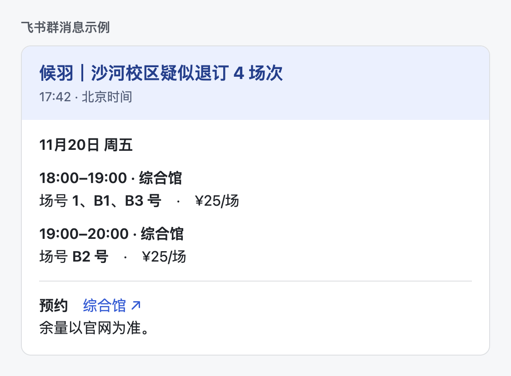
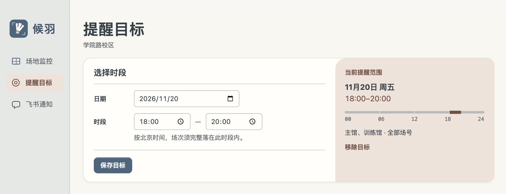

<h1 align="center">候羽</h1>

BUAA Badminton Court Detector · 北航羽毛球退订提醒

## 功能与提醒

等一场下课后的球？选好校区，候羽会留意官网上已预约的场次。遇到疑似退订，飞书会告诉你**哪天、几点、哪个馆、几号场**。点消息里的场馆链接，就能去北航官网预约。

- **看一个校区。** 学院路同时看体育馆主馆和训练馆，沙河同时看综合馆的数字场与 B 区场。首页用绿色列出已核实的可约场号。
- **只等一个时段。** 可以留意全校区，也可以指定日期和时间。例如选 18:00–20:00，这两小时内所有符合条件的场号都能收到。
- **只在有变化时提醒。** 首次打开、每天 07:00 新放号、未付款占位超时只更新列表。同一场持续可约只提醒一次。

<picture>
  <source media="(prefers-color-scheme: dark)" srcset="docs/monitor-dark.png">
  
</picture>

**飞书里的提醒**　下面用示例场次展示实际消息格式。同一时段的场号排在一起，两个时段分行，各自附上价格。

## 下载 v1.8.0

| 系统 | 安装包 | 打开方式 |
| --- | --- | --- |
|  macOS 13+ | [Apple 芯片](https://github.com/squarezier/BUAA-Badminton-Court-Detector/releases/download/v1.8.0/Houyu-macOS-arm64.zip) · [Intel 芯片](https://github.com/squarezier/BUAA-Badminton-Court-Detector/releases/download/v1.8.0/Houyu-macOS-x64.zip) | 解压，打开「候羽」 |
|  Windows 10 / 11 | [Windows x64](https://github.com/squarezier/BUAA-Badminton-Court-Detector/releases/download/v1.8.0/Houyu-Windows-x64.zip) | 完整解压，打开 `Houyu.exe` |
|  Ubuntu 22.04 / 24.04 | [Linux amd64 · DEB](https://github.com/squarezier/BUAA-Badminton-Court-Detector/releases/download/v1.8.0/Houyu-Linux-amd64.deb) | 安装 DEB，在应用菜单打开「候羽」 |

[版本说明](https://github.com/squarezier/BUAA-Badminton-Court-Detector/releases/tag/v1.8.0) · [SHA-256 校验值](https://github.com/squarezier/BUAA-Badminton-Court-Detector/releases/download/v1.8.0/Houyu-SHA256SUMS.txt) · [源码包](https://github.com/squarezier/BUAA-Badminton-Court-Detector/releases/download/v1.8.0/Houyu-Source.zip)

## 使用手册

1. **登录北航。** 点「登录北航」，在学校统一身份认证页输入学号和密码。
2. **连接飞书。** 在接收消息的群里添加「自定义机器人」，把 Webhook 粘贴到候羽的「飞书通知」。如果开启了签名校验，再填签名密钥。点「连接并测试」，到群里查看「候羽｜测试提醒」。
3. **开始等场。** 选校区，再点「开始监控」。如只等某天的球，在「提醒目标」保存日期和起止时间。检查间隔默认 2 分钟，可按需调整，最短 1 秒，从上一轮查询结束后计时。请遵守学校关于高频访问的规定。

查看飞书连接和时段设置图

关闭窗口后，候羽继续在后台监控。Linux 桌面没有托盘图标时，从应用菜单再次打开「候羽」即可回到原窗口。等场期间请保持电脑唤醒、联网。[详细指南与场馆规则](docs/guide.md)

希望候羽能帮总抢不到场的北航同学约到一场球。如果它帮到了你，欢迎在仓库右上角点个 ⭐ **Star**。
