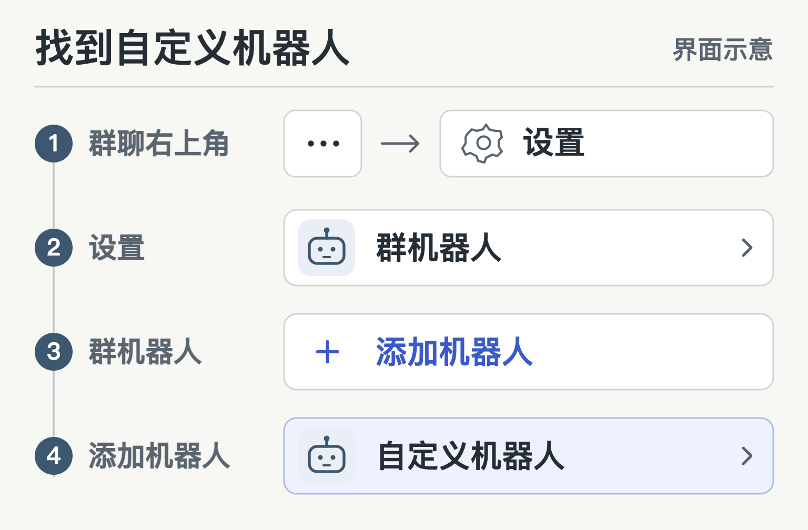
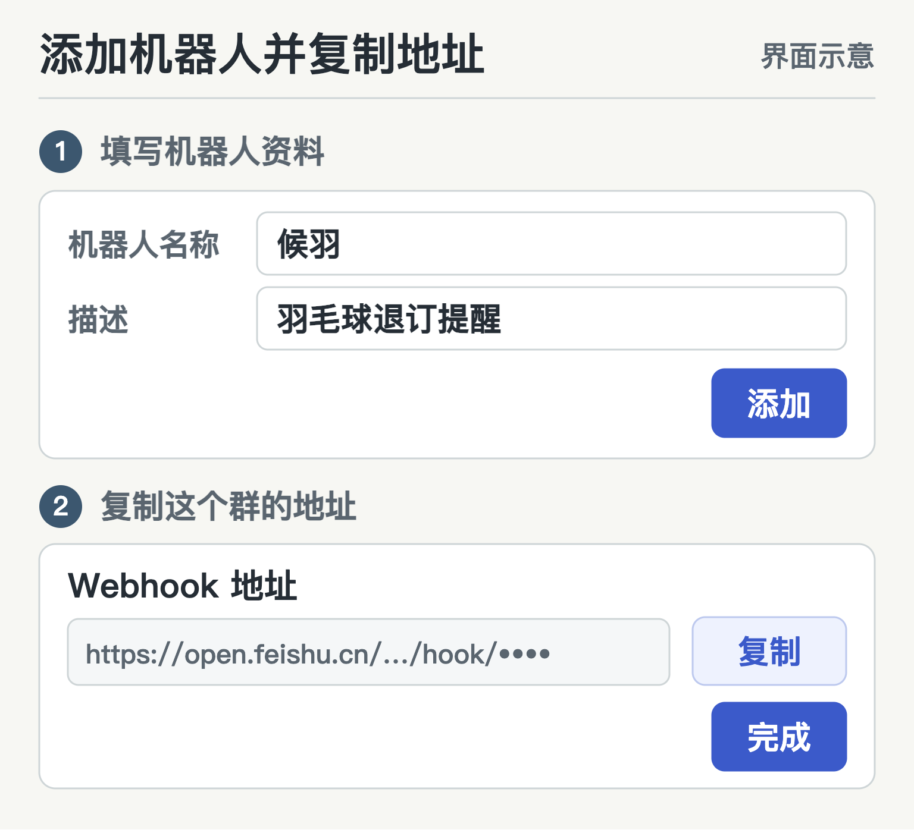
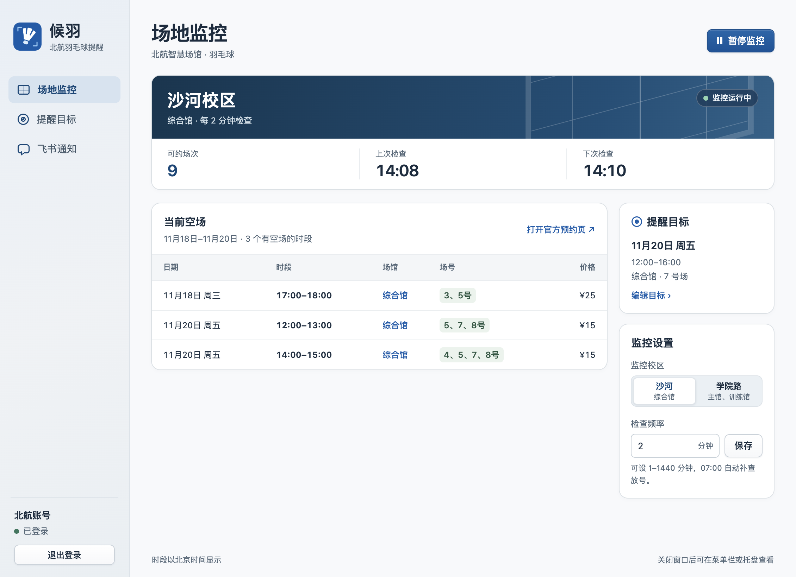

<h1 align="center">候羽</h1>

北航羽毛球退订提醒 · BUAA Badminton Court Detector

想打周五晚上的球，可以在候羽里选「学院路」「周五」「18:00–20:00」。候羽在主馆或训练馆看到符合条件的退订，就会把时段和场号发到飞书群。点消息底部的场馆名，去北航官网订场。

## 下载 v2.1.0

| 电脑 | 下载 | 打开 |
| --- | --- | --- |
|  Mac · macOS 13 及以上 | [Apple 芯片（M 系列）](https://github.com/squarezier/BUAA-Badminton-Court-Detector/releases/download/v2.1.0/Houyu-macOS-arm64.zip) · [Intel 芯片](https://github.com/squarezier/BUAA-Badminton-Court-Detector/releases/download/v2.1.0/Houyu-macOS-x64.zip) | 解压，打开「候羽」 |
|  Windows 10 / 11 | [Windows x64](https://github.com/squarezier/BUAA-Badminton-Court-Detector/releases/download/v2.1.0/Houyu-Windows-x64.zip) | 解压整个文件夹，打开 `Houyu.exe` |
|  Ubuntu 22.04 / 24.04 | [Linux amd64](https://github.com/squarezier/BUAA-Badminton-Court-Detector/releases/download/v2.1.0/Houyu-Linux-amd64.deb) | 安装 DEB，在应用菜单打开「候羽」 |

[版本说明](https://github.com/squarezier/BUAA-Badminton-Court-Detector/releases/tag/v2.1.0) · [SHA-256 校验文件](https://github.com/squarezier/BUAA-Badminton-Court-Detector/releases/download/v2.1.0/Houyu-SHA256SUMS.txt) · [源码包](https://github.com/squarezier/BUAA-Badminton-Court-Detector/releases/download/v2.1.0/Houyu-Source.zip)

## 使用手册

### 登录北航

点候羽的 **登录北航**，在学校统一身份认证窗口登录。输入学号密码时，窗口标题应显示 `sso.buaa.edu.cn`。

### 在飞书群里添加机器人

用**电脑上的飞书**打开收提醒的群。还没有合适的群，可以点头像旁的 **＋ → 创建群组**，建一个叫「羽毛球提醒」的群。以后候羽的消息就发到这里。

群里已经有自己建好的自定义机器人？在 **设置 → 群机器人** 里点开它，从下面第 3 步接着做。

1. 在群聊右上角点 **··· → 设置**，找到 **群机器人**。点 **添加机器人**，在弹出的列表里选 **自定义机器人**。

   

2. 头像可以用默认的。把**机器人名称**填成「候羽」，**描述**填成「羽毛球退订提醒」，然后点 **添加**。群里收到消息时，发消息的就是这个名字。
3. 添加成功后，找到 **Webhook 地址**，点旁边的 **复制**。这串地址告诉候羽要把消息发到哪个群。先切到候羽，打开 **飞书通知**，把刚复制的地址粘贴进 **Webhook** 一栏。

   

4. 切回飞书看 **安全设置**。如果勾了 **签名校验**，把飞书生成的密钥也复制下来，粘贴到候羽的 **签名密钥** 一栏。没开签名校验就留空。如果群里用了 **自定义关键词**，请把「候羽」加入关键词。最后在飞书点 **完成**，以后修改已有机器人时点 **保存**。

   两个窗口可以并排放，先粘贴地址，再复制密钥，以免第二次复制覆盖第一次。切换时让候羽窗口开着，最小化会清空还没提交的输入。地址和密钥只填在候羽里，别发到群聊或提交到 GitHub。

### 发一条测试消息

回到候羽的 **飞书通知**，点 **连接并测试**。打开刚才那个飞书群，看到机器人发来的 **「候羽｜测试提醒」**，就连好了。以后打开候羽可以沿用这个连接。在共用电脑上，勾选 **仅本次使用** 就只用到这次退出。

找不到按钮，或群里没收到测试消息？

- **找不到「自定义机器人」**　先确认打开的是电脑端的群聊。如果群设置中没有添加入口，请群主或管理员检查这个群的机器人权限。
- **关掉页面后找不到地址**　回到原群的「设置 → 群机器人」，点刚才建的机器人，就能再次查看和复制 Webhook。
- **候羽提示签名或关键词错误**　签名密钥要和这个机器人配套，关键词可填「候羽」。改好后回到候羽再测一次。
- **候羽显示已受理，群里没看到**　先从飞书的群机器人列表确认群名和机器人名。可以点候羽里的「发送测试」，按发送时间在那个群里找。

[飞书帮助中心的群机器人说明](https://www.feishu.cn/hc/zh-CN/articles/360024984973) · [飞书自定义机器人与安全设置](https://open.feishu.cn/document/client-docs/bot-v3/add-custom-bot?lang=zh-CN)

### 开始监控

打开 **场地监控**，选 **学院路** 或 **沙河**，点 **开始监控**。想等周五晚上的球，就从左栏进入 **提醒目标**，选好日期、开始和结束时间，点 **保存目标**。同一校区里，落在这段时间内的所有场号都算。

窗口较窄或界面放大时，左栏会收起。点顶部的 **导航与设置** 就能展开。 系统开启「减少动态效果」后，切页和展开侧栏都会立即完成。

<picture>
  <source media="(prefers-color-scheme: dark)" srcset="docs/monitor-dark.png">
  
</picture>

设好后，空场表上方会显示你等的日期和时间。表内写着「目标内」的就是符合范围的行，**绿色数字是可约场号**。表格右上角的日期只用来翻看空场。学院路看主馆和训练馆，沙河看综合馆的数字场和 B 区场。

等场时让电脑保持唤醒、联网。关掉窗口照常监控，退出候羽后停止。

看一眼提醒目标怎么填

## 飞书里会收到什么？

下面这张示例里，沙河 18:00 可以选 1、B1、B3 号场，19:00 可以选 B2。每行对应一个时段，价格跟在场号后面。

第一次查询只记下场地状态。每天早上 7 点放出新场、未付款占位超时，都会刷新空场表。只有观察到原先已预约的场次重新可约，并且符合场馆退订规则，才会发「疑似退订」提醒。检查间隔默认 2 分钟，最短可设为 1 秒，从上轮查完后起算。[场馆规则与常见问题](docs/guide.md)

写给在北航想打球、又总抢不到场的同学。要是候羽帮你约到了一场，欢迎回来点个 ⭐ Star。
