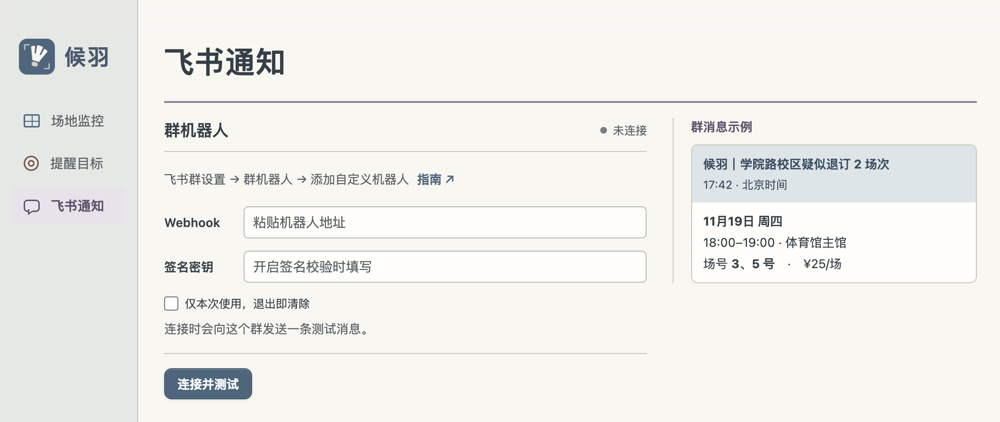

<h1 align="center">候羽</h1>

BUAA Badminton Court Detector · 北航羽毛球退订提醒

## 下载 v1.7.0

| 你的电脑 | 安装包 |
| --- | --- |
| Mac · Apple 芯片（M 系列） | [下载 macOS arm64 版](https://github.com/squarezier/BUAA-Badminton-Court-Detector/releases/download/v1.7.0/Houyu-macOS-arm64.zip) |
| Mac · Intel 芯片 | [下载 macOS Intel 版](https://github.com/squarezier/BUAA-Badminton-Court-Detector/releases/download/v1.7.0/Houyu-macOS-x64.zip) |
| Windows 10 / 11 · x64 | [下载 Windows 版](https://github.com/squarezier/BUAA-Badminton-Court-Detector/releases/download/v1.7.0/Houyu-Windows-x64.zip) |
| Ubuntu 22.04 / 24.04 · x86_64 | [下载 Linux DEB 版](https://github.com/squarezier/BUAA-Badminton-Court-Detector/releases/download/v1.7.0/Houyu-Linux-amd64.deb) |

完整解压后，在 macOS 13 或更新版本打开「候羽」，在 Windows 打开 `Houyu.exe`。Linux 在下载目录运行 `sudo apt install ./Houyu-Linux-amd64.deb`，然后在应用菜单打开「候羽」。[打开应用](docs/guide.md#打开应用) · [源码](https://github.com/squarezier/BUAA-Badminton-Court-Detector/releases/download/v1.7.0/Houyu-Source.zip) · [SHA-256 校验](https://github.com/squarezier/BUAA-Badminton-Court-Detector/releases/download/v1.7.0/Houyu-SHA256SUMS.txt) · [版本说明](https://github.com/squarezier/BUAA-Badminton-Court-Detector/releases/tag/v1.7.0)

## 使用手册

### 1. 连接飞书

在飞书群里添加「自定义机器人」。打开候羽的「飞书通知」，粘贴 Webhook，点 **连接并测试**。若机器人开启了签名校验，同时填入签名密钥。在群里收到「候羽｜测试提醒」即已连通。共用电脑可勾选「仅本次使用」。

### 2. 登录并开始监控

点左下角 **登录北航**，在学校官网完成认证。选择校区，按需修改并保存检查间隔，点 **开始监控**。下图是运行后的示例，绿色数字是可约场号，点场馆名即可打开对应的官网预约页。

<picture>
  <source media="(prefers-color-scheme: dark)" srcset="docs/monitor-dark.png">
  
</picture>

### 3. 只等想打的时段（可选）

在 **提醒目标** 选好日期和起止时间，点 **保存目标**。例如选学院路 18:00–20:00，主馆和训练馆完整落在这个范围内的场次都会纳入提醒。空场表用「目标时段」标出对应行。移除目标可恢复该校区全部退订提醒。

**何时推送？** 同一场次上次已预约、本次变为绿色可约时，候羽才向飞书发送疑似退订。首次查询和每天北京时间 07:00 正常放号只刷新列表。官网标记的闭馆活动也会排除。电脑保持唤醒、联网，关掉窗口后仍可在菜单栏或托盘找到候羽。[详细指南](docs/guide.md)
