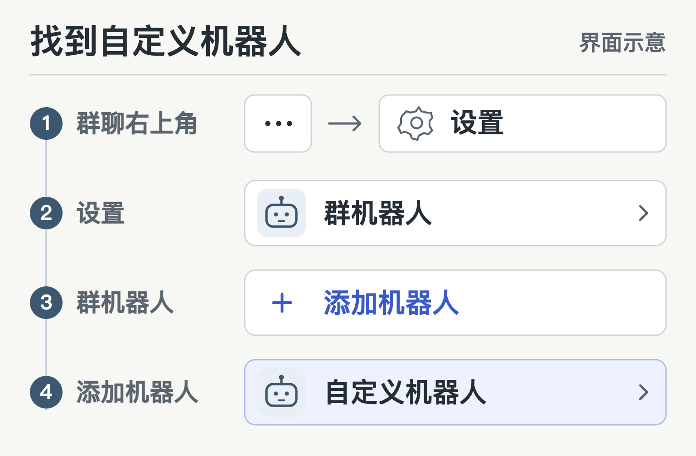
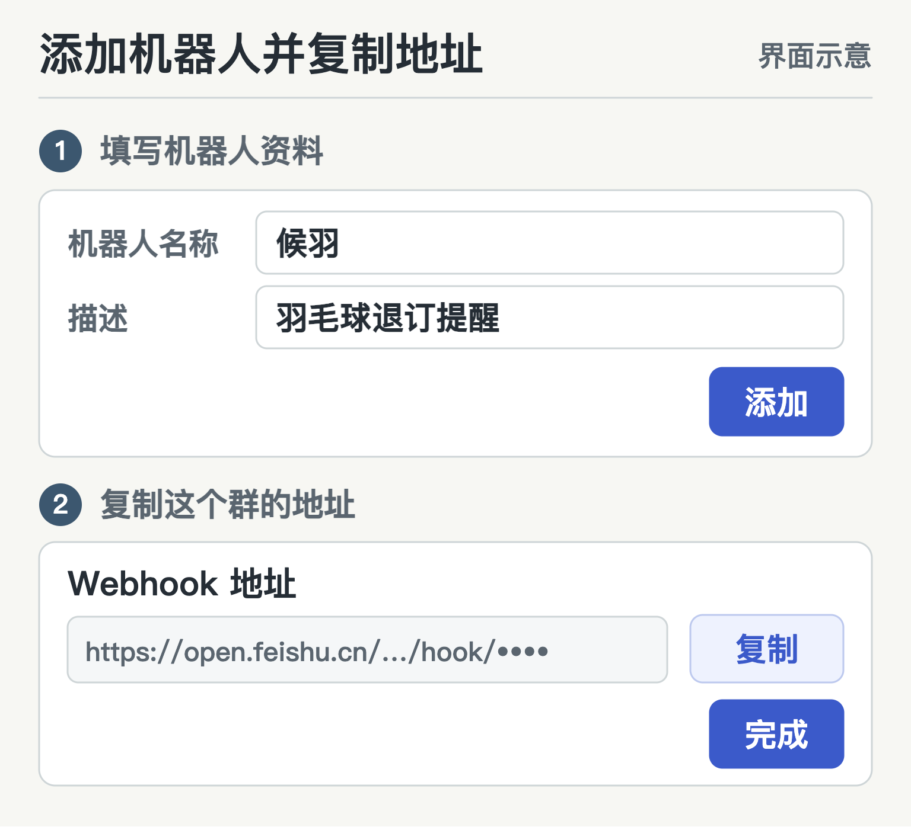
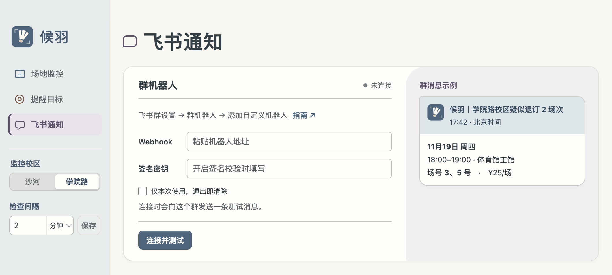
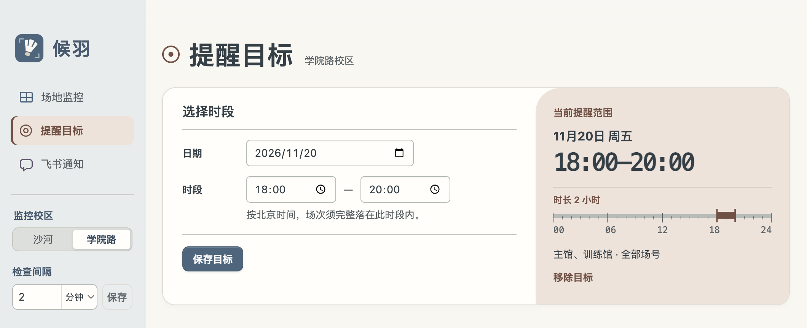
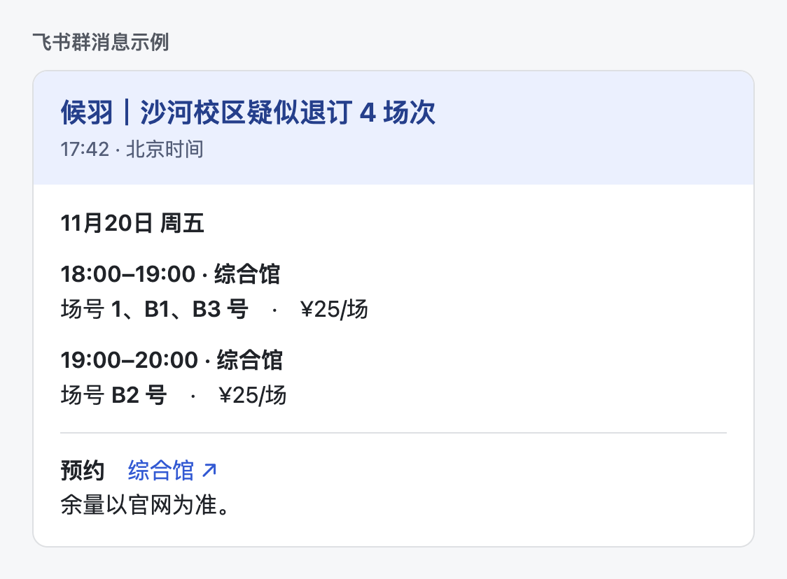

# 候羽使用手册

## 打开应用

| 系统 | 安装和启动 |
| --- | --- |
| macOS 13 及以上 | 在苹果菜单的「关于本机」看芯片型号。M 系列下载 arm64，Intel 下载 x64。解压后打开「候羽」。 |
| Windows 10 / 11 x64 | 将 ZIP 完整解压，在 `Houyu` 文件夹中打开 `Houyu.exe`。 |
| Ubuntu 22.04 / 24.04 amd64 | 在下载目录运行 `sudo apt install ./Houyu-Linux-amd64.deb`。安装好后在应用菜单打开「候羽」，也可以运行 `houyu`。 |

升级时从菜单栏或托盘退出旧版，再打开新版。校区、检查间隔、提醒目标和飞书连接会保留。学校登录只对本次运行有效。

Mac 包采用临时签名，尚未公证。Windows 包尚无发布者签名。系统可能会提示无法验证发布者。发布页提供 SHA-256 校验值。Windows x64 包在 Server 2022 和 Windows 11 ARM 的兼容环境中做过桌面测试，本版没有单独的 Windows 10 实机结果。

## 第一次使用

点候羽的 **登录北航**，在学校统一身份认证窗口登录。输入学号密码时，窗口标题应显示 `sso.buaa.edu.cn`。

### 在飞书群里添加机器人

用**电脑上的飞书**打开收提醒的群。还没有合适的群，可以点头像旁的 **＋ → 创建群组**，建一个叫「羽毛球提醒」的群。以后候羽的消息就发到这里。

群里已经有自己建好的自定义机器人？在 **设置 → 群机器人** 里点开它，从下面第 3 步接着做。

1. 在群聊右上角点 **··· → 设置**，找到 **群机器人**。点 **添加机器人**，在弹出的列表里选 **自定义机器人**。

   

2. 头像可以用默认的。把**机器人名称**填成「候羽」，**描述**填成「羽毛球退订提醒」，然后点 **添加**。群里收到消息时，发消息的就是这个名字。
3. 添加成功后，找到 **Webhook 地址**，点旁边的 **复制**。这串地址告诉候羽要把消息发到哪个群。先切到候羽，打开 **飞书通知**，把刚复制的地址粘贴进 **Webhook** 一栏。

   

4. 切回飞书看 **安全设置**。如果勾了 **签名校验**，把飞书生成的密钥也复制下来，粘贴到候羽的 **签名密钥** 一栏。没开签名校验就留空。如果群里用了 **自定义关键词**，请把「候羽」加入关键词。最后在飞书点 **完成**，以后修改已有机器人时点 **保存**。

   两个窗口可以并排放，先粘贴地址，再复制密钥，以免第二次复制覆盖第一次。切换时让候羽窗口开着，最小化会清空还没提交的输入。地址和密钥只填在候羽里，别发到群聊或提交到 GitHub。

### 发一条测试消息

回到候羽的 **飞书通知**，点 **连接并测试**。打开刚才那个飞书群，看到机器人发来的 **「候羽｜测试提醒」**，就连好了。以后打开候羽可以沿用这个连接。在共用电脑上，勾选 **仅本次使用** 就只用到这次退出。



<details>
<summary>找不到按钮，或群里没收到测试消息？</summary>

- **找不到「自定义机器人」**　先确认打开的是电脑端的群聊。如果群设置中没有添加入口，请群主或管理员检查这个群的机器人权限。
- **关掉页面后找不到地址**　回到原群的「设置 → 群机器人」，点刚才建的机器人，就能再次查看和复制 Webhook。
- **候羽提示签名或关键词错误**　签名密钥要和这个机器人配套，关键词可填「候羽」。改好后回到候羽再测一次。
- **候羽显示已受理，群里没看到**　先从飞书的群机器人列表确认群名和机器人名。可以点候羽里的「发送测试」，按发送时间在那个群里找。

[飞书帮助中心的群机器人说明](https://www.feishu.cn/hc/zh-CN/articles/360024984973) · [飞书自定义机器人与安全设置](https://open.feishu.cn/document/client-docs/bot-v3/add-custom-bot?lang=zh-CN)

</details>

### 开始监控

打开 **场地监控**，选 **学院路** 或 **沙河**，点 **开始监控**。想等周五晚上的球，就从左栏进入 **提醒目标**，选好日期、开始和结束时间，点 **保存目标**。同一校区里，落在这段时间内的所有场号都算。

窗口较窄或界面放大时，左栏会收起。点顶部的 **导航与设置** 就能展开。

## 只等某天的一段时间

例如周五只有 18:00–20:00 有空，就在「提醒目标」选周五，再选 18:00 和 20:00，点「保存目标」。18:00–19:00、19:00–20:00 两场都在范围内，该校区所有球场都算。时间按北京时区计算。保存后回到首页，空场表上方就能看到目标日期和时段。



首页表格右上角可按日期浏览，浏览其他日期不会改动这里保存的目标。两个校区各记一个目标，软件只查询当前校区。可以提前选尚未放号的日期，也可以在监控中改时间。目标结束后，这个校区的提醒会暂停。换个日期可继续等，点「移除目标」可恢复所有时段。

## 为什么看得到空场，却没收到飞书？

| 官网发生的事 | 候羽怎么处理 |
| --- | --- |
| 开始监控时已经有绿色空场 | 列在首页，记下第一轮状态。 |
| 每天北京时间 07:00 放出新一天，或未付款占位超时 | 更新空场表。学校每天开放含当天在内的三天，付费场下单后须在一分钟内付款。 |
| 上次已预约，这次变绿，符合目标范围和场馆规则 | 发「疑似退订」，按日期、时段、场馆、价格合并场号。点卡片底部的场馆名去官网预约。 |
| 某个日期暂时读不到，或官网标色与状态冲突 | 界面显示待核验，继续看其他日期。恢复后与该日上次成功读到的状态比较。 |
| 飞书限流 | 延后重试，发送前重新确认场次仍为绿色。网络中断后若无法确认是否已送达，可在群里核对。 |



学院路训练馆和沙河综合馆的付费场须至少提前三小时退订。如果上次看见已预约时就已经过了截止时间，后来变绿的场仍列在首页。两次查询刚好跨过截止时间，则仍有可能是正常退订。学院路主馆按自己的预约表和闭馆公告判断。[学院路主馆](https://cgyy.buaa.edu.cn/venue/venue-reservation/38) · [训练馆须知](https://cgyy.buaa.edu.cn/venue/venue-reservation/39) · [沙河须知](https://cgyy.buaa.edu.cn/venue/venue-reservation/57)

两馆须知还要求每人每天最多连续预约两小时，同一时段限一片场。每场登记 2–4 名实际到场人员，可提前 15 分钟入场。学校禁止转让、倒卖及高频恶意访问。下单前请核对所选馆当日的须知。

## 关掉窗口还能等场吗？

可以。点菜单栏或托盘图标可以回来。Linux 桌面没有托盘时，从应用菜单再打开一次即可，Ctrl+Q 会退出。电脑休眠时查询暂停，唤醒后补查。学校登录过期时，请重新登录并开始监控。

间隔默认 2 分钟，支持 1 秒至 24 小时。每轮从上轮读完后开始计时，加载网页和翻页还需要时间。两次查询之间短暂空出、又被订走的场地可能看不到。遇到官网限流，候羽会延后再查。

## 账号与飞书密钥

学号和密码直接填在学校页面。候羽用单独的内存会话打开这个页面，退出登录或退出应用都会结束会话。飞书卡片里只有场地信息和官网预约入口。

飞书连接由系统安全存储保护。Mac 使用钥匙串，Windows 使用当前用户的 DPAPI，Linux 使用系统密钥环或 Secret 门户。在共用电脑上可以选「仅本次使用」。Linux 没有可用密钥环时只在内存中保留连接。关闭窗口或电脑休眠时会清掉还没提交的 Webhook 和签名密钥。macOS 和 Windows 锁屏时也会清除。三个系统上，输入后五分钟没再修改也会自动清除。点「重新解锁」可重试读取系统密钥，点「断开连接」可移除本机保存的连接。[Electron 安全存储说明](https://www.electronjs.org/docs/latest/api/safe-storage)

## 从源码运行

需要 Node.js 22.12 或更新版本。项目按锁文件安装 Electron 45.4.1，打包时核对官方运行时 ZIP 的 SHA-256。[Electron 发行说明](https://releases.electronjs.org/release/v45.4.1)

```sh
npm ci
npm test
npm start
```

在独立测试目录运行桌面回归。测试使用虚构的登录、场地和推送数据。

```sh
npx electron test/desktop-production.cjs ./qa/production
npx electron test/desktop-smoke.cjs ./qa/preview
```

Mac 构建需要 `ditto`、`sips` 和 `codesign`，Linux DEB 使用 `dpkg-deb`。Windows x64 包可用 Python 3 和锁定的 Node.js 依赖构建。

```sh
python3 scripts/package.py darwin-arm64 ./runtime ./staging ./Houyu-macOS-arm64.zip
python3 scripts/package.py win32-x64 ./runtime ./staging ./Houyu-Windows-x64.zip
python3 scripts/package.py linux-x64 ./runtime ./staging ./Houyu-Linux-amd64.deb
```
